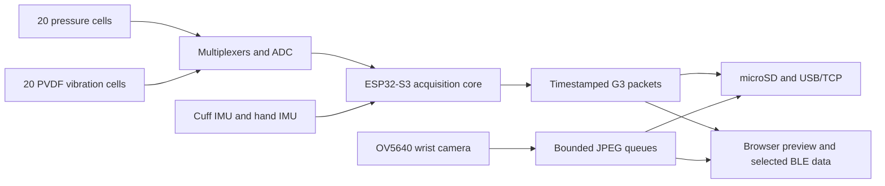

# Architecture

## Physical and data flow

The sensor laminate reuses the pressure/PVDF stack and labelled harness from V3. V4 adds the camera, larger power/storage design and separate cuff/hand motion streams. The acquisition core owns the 250 μs tactile scan budget; the camera driver, SD bus and preview queues have distinct ownership.

## Ownership and timing

- **ADC/multiplexers:** the core schedules 20 dynamic channels at 4 kHz and pressure at 50 Hz. The implemented settling budget is 24 μs for pressure and 6 μs for acoustic samples; actual mixed-load timing remains a hardware measurement.
- **Camera:** driver buffers are copied into bounded PSRAM ownership. Shared JPEG references serve recording/network/browser work; send deadlines and queue-loss counters make slow consumers visible.
- **Storage/full streams:** USB, TCP and SD retain timestamped checksummed records and quality/loss metadata. A tactile pause and camera recording are separate states.
- **Preview:** the browser has its own 64-packet queue and independent sequence. Selected waveform/feature data supports inspection while complete acquisition has its own owners.
- **Power:** battery/USB qualification, expander writes, camera rails, ADC calibration and shutdown acknowledgements form explicit state transitions. Fault injection covers software ordering; electrical behaviour requires device tests.

The [firmware guide](../firmware/tactile_v4/README.md) has exact pins, queues, rates and task/bus ownership. [Protocol](../firmware/tactile_v4/PROTOCOL.md) defines the bytes. [Shutdown review](../hardware/glove-v4/verification/shutdown/README.md) records corrections and remaining hardware-reset work.

## Credentials and local boundaries

The local design server binds to `127.0.0.1` and serves a fixed public-file subset. A physical cuff uses its own generated WPA2 key; BLE enrollment is limited by a physical pairing window and encrypted bonds. Just Works pairing has a specific MITM limitation described in the firmware guide. The device HTTP/WebSocket boundary checks same-origin browser connections and bounded commands. Your own device configuration stays with your device.

## Geometry and native source

The enclosure generator uses the recorded component-placement source, package-height evidence and harness envelopes. Its independent verifier reloads emitted STLs and checks nominal meshes, collisions, access paths and contact relationships. Native KiCad sources are included alongside component/net maps; historical fabrication manifests cover the earlier V3 board and the separate V4 hand tile. Main-board manufacturing release waits for current routing and process qualification.
