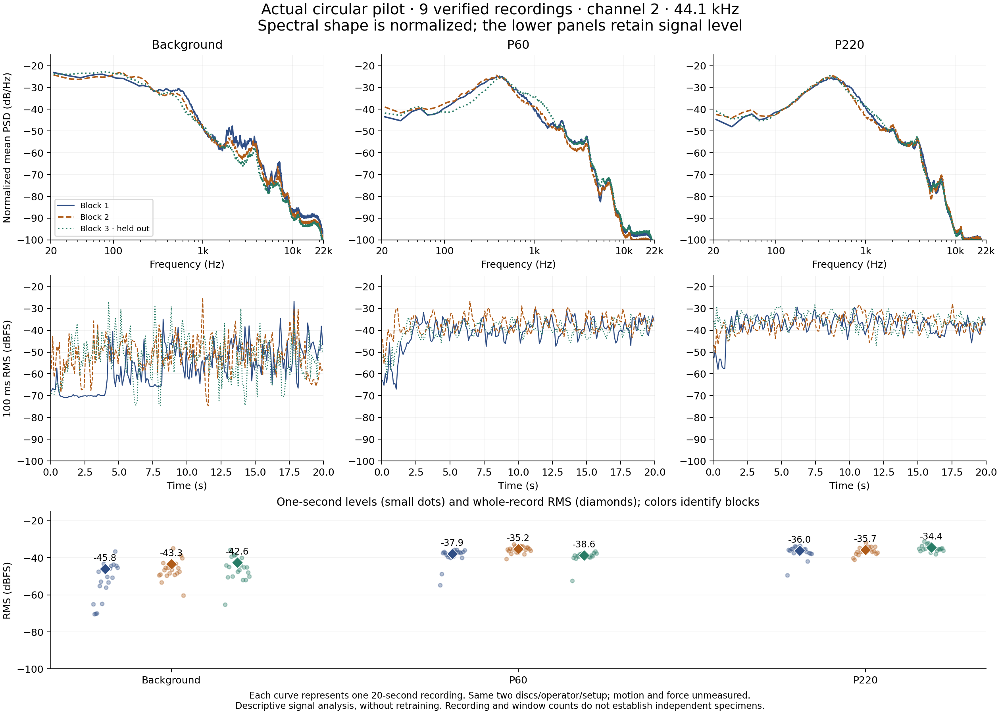

# Bela sensing experiment

This is an earlier physical piezo experiment, separate from the V4 cuff design. Nine saved 20-second takes cover background, P60 and P220 surfaces on channel 2 at 44.1 kHz. The figure shows recorded traces, normalized spectral density and RMS from the same setup.

A saved-clip evaluation classified three held-out recordings correctly. Sustained live P60/P220 testing disagreed with that result, including when replaying a saved scratch. Force and motion were unmeasured. Mounting, gain, repeatability and the distinction between saved-clip evaluation and live behaviour therefore remain part of the interpretation.

The plot is retained as achieved experimental evidence. V4 adds a different sensor/ADC/firmware/enclosure architecture and still needs its own assembled-device measurements. Raw recordings, model state and private experimental labels remain in the original research archive.
