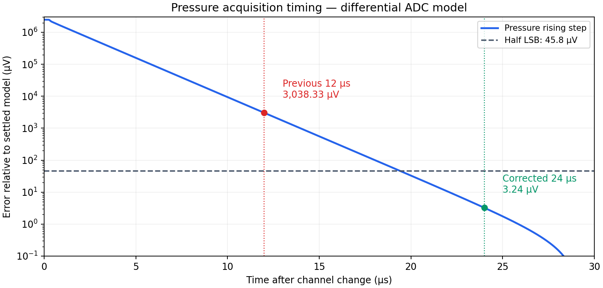

# Differential ADC simulation

The high-capacitance pressure rising-step case exposed an insufficient 12 µs acquisition wait. The firmware now uses 24 µs for pressure and retains 6 µs for acoustic channels. All five extended native runs complete and meet the half-LSB settling criterion at those windows.

| Case | Wait, µs | Last half-LSB crossing, µs | Sample residual, µV | Modeled DC error, µV |
|---|---:|---:|---:|---:|
| dynamic-up | 6 | 5.262 | 18.290 | 122.890 |
| dynamic-down | 6 | 5.262 | -18.290 | 175.143 |
| pressure-up | 24 | 19.420 | -3.244 | 105.926 |
| pressure-down | 24 | 10.675 | 0.001 | 21362.533 |
| dynamic-resistance-stress | 6 | 5.726 | 32.571 | 121.182 |

With the longer settled reference, the old12 µs pressure-up residual is -3038.33 µV;24 µs gives -3.24 µV. The full scan allocates144 µs to settling plus21 µs conversion and21 µs serial clocks, leaving64 µs of a250 µs frame for other overhead. That arithmetic still requires physical timing qualification.

## Exact scope

Both OPA320 paths and the OPA4323 bank buffer use the retained original TI equations. The actual22 Ω/1 nF positive and negative buckets and canonical pin mappings are checked. Each input sees a200 Ω/31 pF continuous acquisition equivalent. The native80 µs endpoint, finite samples, diagnostics and completion marker are required before evaluating results. Full traces are retained compressed.

The mux1–2 kΩ/80–160 pF/40–80 pF values are engineering stress assumptions. A10 kΩ source and a full0→2.5 V transition deliberately combine a high source impedance with a maximum step. Supply3.3 V and midpoint1.25 V remain ideal boundaries. The SAR converter is not modeled transistor by transistor; switching charge, reference pulses, temperature, EMI and board/cable parasitics remain separate checks.

The modeled zero-voltage input bottoms near21.39 mV because amplifier outputs cannot reach an ideal ground rail. This is a DC endpoint issue, separate from settling. Pressure calibration must capture the assembled channel’s unloaded endpoint and loaded response. A normalized voltage is not calibrated force.

Original12 µs cases are retained as diagnostic evidence under the scratch review; the published runner binds its waiting times to the current firmware contract. It also supports a separately labeled bias-ramp sensitivity run.

Reproduce: `python3 hardware/glove-v4/verification/differential-adc/run.py --work /tmp/glove-adc-check`. Requires NumPy and the recorded ngspice42/XSPICE model environment.
