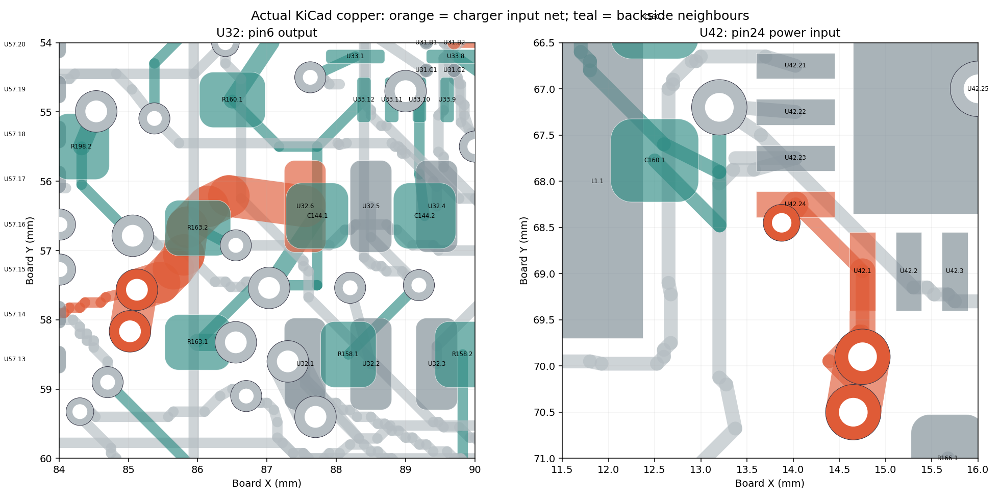
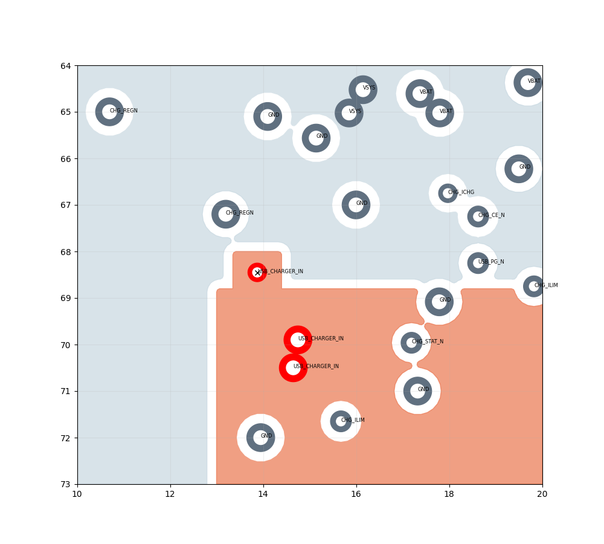

# USB power escapes: reviewed candidate

This revision widens U32's output route and gives U42's actual VBUS input a short, direct connection to POWER_A. All 561 components and their canonical pin/net mappings are preserved. The reviewed correction is now applied to the canonical board, which has **20 open connections and zero physical DRC errors** under the retained KiCad project settings. The candidate archive remains beside this record for provenance.

| Item | Previous candidate | This candidate |
|---|---:|---:|
| U32 pin 6 output route | 2.926 mm × 0.15 mm | 3.149 mm × 0.60 mm |
| Selected 10°C long-conductor width screen | Fails | Passes; calculated requirement 0.529 mm |
| U42 pin 24 surface escape | 3.225 mm × 0.28 mm | 0.250 mm × 0.28 mm |
| USB positive copper estimate at 50°C | 51.484 mΩ | 35.640 mΩ |
| Calculated drop at 1.348 A | 69.409 mV | 48.048 mV |
| Battery positive + return estimate | 13.544 mΩ | 13.559 mΩ, within the 15 mΩ allocation |

These are finite DC estimates under the recorded minimum-copper and plating assumptions. The calculated USB copper reduction is 30.8%; whole-device power, temperature and runtime do not improve by that percentage.

## Native geometry



U32's former route cannot simply be widened: two neighbouring vias obstruct it. Seven 0.6 mm F.Cu segments go around those obstacles. Its existing through-vias remain at `(85.1229,57.5659)` and `(85.0229,58.1659)` mm.

U42 pin 24 is VBUS; pin 1 is VAC sensing. A 0.25 mm fanout reaches a new 0.4 mm land / 0.2 mm finished-hole through-via at `(13.875,68.450)` mm. It overlaps the solder land, so the manufacturing specification must include filled, capped and planarized via-in-pad treatment. The calculated barrel loss at the 1.282 A main-branch bound is 2.42 mW; the short surface escape contributes 1.01 mW. Those losses are inputs to thermal qualification, rather than a measured temperature rise.



The first proposal exposed a real connectivity failure: the new via lay 0.35 mm outside the USB plane outline. Physical clearance checking alone did not catch it as a new net open because a thin alternate connection remained. The accepted candidate extends the priority-2 USB_CHARGER_IN outline by a 0.84 mm² tab. The native filled-area test and the regenerated resistor-sheet model now both connect to the new via. VSYS's outline is unchanged; its fill and resistance were recomputed because the higher-priority tab displaces some copper.

## Evidence and reproduction

- `unapplied-candidate.kicad_pcb.gz`: exact native board archive, decompressed SHA-256 `973111f03d52a0288c53378c9ba5df2dc6b7ac896ce2e6f88557ab0d7846a84b`; the same reviewed board is applied at `hardware/glove-v4/electrical/glove-v4-routing-candidate.kicad_pcb`.
- `candidate.kicad_pro`, `candidate.drc.txt`: project settings and saved native DRC. Detached library lookup warnings remain recorded, alongside baseline dangling tracks/vias and one copper-sliver warning.
- `candidate.changes.json`, `output-route.json`, `propose.py`: exact copper mutation recipe from the prior board hash `53d0d956f016748fcdcfb6cd0ae84dfd56f47e43a227efb4d26c83fc53c5bcb5`. No footprint placement or pin/net mutation.
- `independent-review.py` and `.json`: native footprint/track/zone comparison and plane-contact checks. The independent review was strengthened with fail-closed assertions before archiving.
- `power-model/`, `power-results/`: regenerated six-plane, battery and USB-inlet estimates; every result identifies this exact board. Meshes use 0.10/0.075 mm grids, adding 0.05 mm for USB until the last resistance change falls below 5%.
- `audit_usb_pair.py`, `usb-pair-audit.json`: unchanged USB data-pair geometry, 90.58 Ω nominal closed-form estimate, less than 0.001 mm geometric mismatch, and continuous adjacent ground beneath the checked surface traces. Fabricator stackup/impedance and physical USB validation remain required.
- `tests/test_glove_power_escape_review.py`: native positive and adversarial terminal-validation tests, coarse-grid rejection and saved-board/evidence hash consistency.

The plane solver rejects terminals outside the actual fill, a wrong net/layer, coordinates without a matching native pad/via, empty or nonfinite inputs, empty raster contacts and disconnected terminal components. `--validate-only` exercises physical terminal identity without running the mesh. In `gate-tests.json`, a negative case's `passed: false` records the expected solver rejection.

With KiCad 7 Python, numpy, scipy and Shapely 2 available, decompress the archive to a scratch `candidate.kicad_pcb`, copy `candidate.kicad_pro` beside it, and retain the `.drc.txt` beside that board. From this directory:

```sh
python3 power-model/run_audit.py /scratch/candidate.kicad_pcb /scratch/power-results
python3 power-model/plane_dc_audit.py /scratch/candidate.kicad_pcb /scratch/power-results/vbus-inlet-0.1.json 0.1 power-model/vbus-inlet-config.json
python3 power-model/plane_dc_audit.py /scratch/candidate.kicad_pcb /scratch/power-results/vbus-inlet-0.075.json 0.075 power-model/vbus-inlet-config.json
python3 summarize.py /scratch/candidate.kicad_pcb /scratch/power-results
python3 audit_usb_pair.py /scratch/candidate.kicad_pcb /scratch/usb-pair-audit.json
```

`propose.py SOURCE_BOARD OUTPUT_BOARD` reconstructs the mutation from the prior candidate. Its source project file must be beside it; use this review's unchanged `.kicad_pro` if extracting the older archive. Newly generated track UUIDs can change the byte hash, so reconstructed output requires its own DRC and bound reports. `independent-review.py ORIGINAL CANDIDATE OUTPUT_JSON` requires saved `.drc.txt` files beside both boards.

## Remaining release work

The 20 open signal connections, full USB ground-return/recovery-path analysis, local and enclosed thermal performance, converter transient qualification, reset/temperature proposal integration and manufacturing acceptance remain open. The selected long-trace width screen applies to U32's widened route; U42's short package escape still requires the full thermal/assembly review. The 15 µm barrel-plating minimum remains an engineering assumption for the fabricator to confirm.

A bounded attempt to bridge IO1_SPARE4 directly on SIGNAL_TOP found no clear 0.15 mm path within the inspected local region. That net and its existing routing are unchanged; a reviewed layer transition or wider reroute is the next step.

This folder is review evidence for the applied canonical correction. It adds no released Gerbers, ordering package or claim of fabricated-hardware performance. See the main glove README for size, runtime, thermal and procurement status.
